---

### ᗧ···👻 草（毎日 03:00 JST に食べ直し）

<picture>
  <source media="(prefers-color-scheme: dark)" srcset="https://raw.githubusercontent.com/chris9609/chris9609/output/pacman-contribution-graph-dark.svg" />
  <source media="(prefers-color-scheme: light)" srcset="https://raw.githubusercontent.com/chris9609/chris9609/output/pacman-contribution-graph.svg" />
  
</picture>

---

### 🛠️ よく使う道具

  

